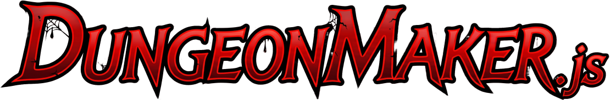

<p align="center"></p>

# dungeonmaker.js

An **unofficial** WebAssembly port of [DungeonMaker 2.05](http://dungeonmaker.sourceforge.net/)
by Peter Henningsen, a procedural dungeon generator, created and maintained by
[spearwolf](https://www.spearwolf.de). It ships as the npm package
[`dungeonmaker-js`](packages/dungeonmaker-js): WebAssembly core, Web Worker client, render and
export helpers, and a Node CLI. The same design and seed give the same dungeon on every platform.

- **Demo, guides and API reference:** <https://spearwolf.github.io/dungeonmaker.js/>
- **npm:** <https://www.npmjs.com/package/dungeonmaker-js>
- **Package README** (install and quick start): [`packages/dungeonmaker-js`](packages/dungeonmaker-js/README.md)
- **Changelog:** [`packages/dungeonmaker-js/CHANGELOG.md`](packages/dungeonmaker-js/CHANGELOG.md)
- **Design of the package:** [`docs/superpowers/specs/2026-10-31-dungeonmaker-package-design.md`](docs/superpowers/specs/2026-10-31-dungeonmaker-package-design.md)

## Development

The toolchain is pnpm with versions pinned in `mise.toml`; run tools through `mise x -- …` if they
are not on your `PATH`.

```sh
pnpm lint            # Biome and SPDX headers
pnpm typecheck
pnpm test            # Vitest: package, scripts and site
pnpm build           # the package
pnpm site:dev        # builds the package, then serves the site
pnpm site:build      # production build of the site
sh native/test/run.sh   # native tests (GCC and clang) against the golden hashes
sh native/build.sh      # rebuilds the wasm in a pinned Emscripten container
```

`CLAUDE.md` has the full command list, the determinism contract and the gotchas of the vendored
library. Releases are described in [`RELEASING.md`](RELEASING.md).

## Origins

DungeonMaker was written by Dr. Peter Henningsen (alifegames) from 2001 on; Aaron Dalton
contributed to it and prepared release 2.05 in 2005, the last one upstream. Its sources are
vendored unchanged in [`native/vendor/dungeonmaker-2.05`](native/vendor/dungeonmaker-2.05).

[spearwolf](https://www.spearwolf.de) carries the project on out of joy in dungeons, mazes and
JavaScript, and because it seemed a shame to leave the original lying around orphaned: first as an asm.js port in 2014, since 2026 as
the WebAssembly package, CLI and site. More on the
[About page](https://spearwolf.github.io/dungeonmaker.js/about).

## Legacy

The original 2014 asm.js version is preserved at the git tag `legacy-2014`, its demo at
`legacy-2014-demo`.

## License

GPL-3.0-or-later; includes a modified version of DungeonMaker 2.05 © Peter Henningsen.
Port, package and site by [spearwolf](https://www.spearwolf.de). See `LICENSE` and `NOTICE`.
